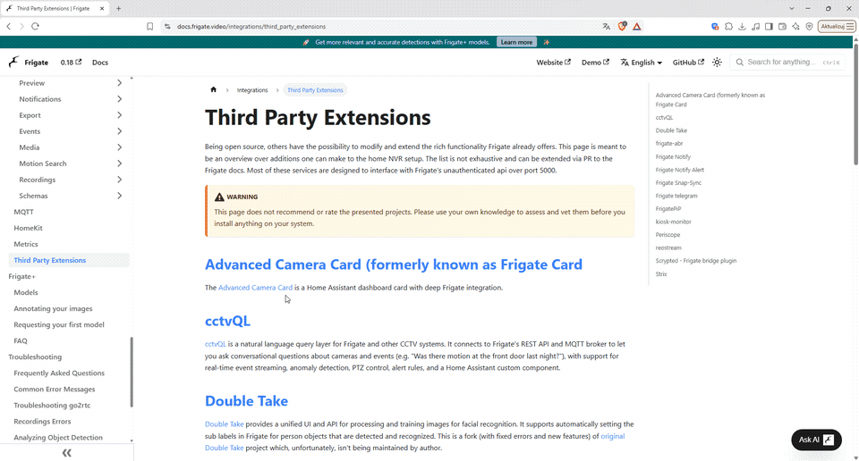

# FrigatePiP

[](https://github.com/maciejgornicz/frigate-pip/releases/latest)
[](https://github.com/maciejgornicz/frigate-pip/actions/workflows/build.yml)
[](LICENSE)
[](https://ko-fi.com/maciejgornicz)

**Instant picture-in-picture camera windows for [Frigate NVR](https://frigate.video) on Windows — and on Linux.**



When Frigate detects a person, a car or any other object, FrigatePiP pops up a small window with that camera's live video in a corner of your screen — within milliseconds — and closes it again when nothing moves any more.

- **[Windows](#windows):** a tray application whose windows appear over everything; it takes about 5–10 MB of memory and practically no CPU while waiting.
- **[Linux](#linux):** the same windows on a Linux desktop (X11, or Wayland with XWayland), on a computer without a desktop (e.g. a Raspberry Pi with a monitor), inside a terminal or as tmux popups.

**User guide:** [English](docs/en/user-guide.md) · [Polski](docs/pl/user-guide.md) · [Deutsch](docs/de/user-guide.md) · [Español](docs/es/user-guide.md) · [Português](docs/pt/user-guide.md) · [Français](docs/fr/user-guide.md)

## Windows

### Features

- **Fast:** the window appears ~5 ms after Frigate's message, Frigate's snapshot is shown ~35 ms later, and smooth live video follows (well under a second; almost instantly with the optional prebuffer).
- **Live video from go2rtc (RTSP)** with hardware decoding of H.264 and H.265 (Media Foundation + Direct3D 11), up to 4K, or MJPEG / snapshots when RTSP is not available.
- **Camera audio** (AAC, G.711) on a separate thread, so it never delays the picture.
- **Filters:** cameras, objects, required zones, minimum confidence, stationary objects; every object, or Frigate *Review* alerts / detections only.
- **Manual events** created through Frigate's API (e.g. by a Home Assistant automation when the doorbell rings) open a window too.
- **Windows the way you like them:** monitor, corner, size, timing, how many at once, replace the oldest or skip, always on top, caption, notification sound, quiet during full-screen games and presentations.
- **Mouse control:** drag to move, click to pin, wheel to resize, Ctrl + wheel to zoom in where the mouse points, Ctrl + drag to move the zoomed picture, speaker button to mute, × or right-click to close, double-click to open the camera in Frigate.
- **Settings window** with a live preview of your changes, a connection test and a description of every option.
- **Events via the Frigate WebSocket** (nothing else needed) or via **MQTT**.
- **Updates itself:** checks GitHub once a day and installs a new version with one click (can be switched off).
- **Six languages** — English, Polski, Deutsch, Español, Português, Français — chosen automatically from the Windows display language.
- A single small executable (~0.7 MB) with no runtime dependencies; per-user installer, no administrator rights.

### Installation

1. Download **`FrigatePiP-<version>-installer.exe`** from [Releases](https://github.com/maciejgornicz/frigate-pip/releases/latest).
2. Run it (no administrator rights needed). If Windows SmartScreen says *“Windows protected your PC”*, click **More info → Run anyway** — the program is not code-signed.
3. Keep **Start FrigatePiP with Windows** checked if you want it to start automatically, and finish with **Launch FrigatePiP**.
4. The settings window opens. Enter your **Frigate address** (for example `http://192.168.1.10:5000`, or `https://192.168.1.10:8971` together with a Frigate user and password), click **Test connection**, then **OK**.

Prefer no installer? Download `FrigatePiP-<version>-portable.exe` from the same release and run it from any folder.

**Requirements:** Windows 10 (1809+) or 11, 64-bit; Frigate reachable on its API port **5000** (`http://`, no login — in the Home Assistant add-on, enable it in the add-on's network settings) or **8971** (`https://`, with a Frigate user; the viewer role is enough), also through a reverse proxy, and, for live video, go2rtc's RTSP port **8554**. On Windows N editions without the Media Feature Pack, live video falls back to MJPEG. Details, updating and uninstalling: [user guide → Installation](docs/en/user-guide.md#2-installation).

### Usage in short

- **Left-click** the tray icon to open the settings; **right-click** for the menu (show a camera, pause notifications, open Frigate, help, log, exit).
- Hover over any option in the settings window to see what it does; **F1** opens the guide.
- Settings are stored in `%APPDATA%\FrigatePiP\config.ini`; the log in `%APPDATA%\FrigatePiP\frigate-pip.log`.
- Command line: `frigate-pip.exe --settings`, `--test <camera>`, `--quit`.

Everything is described in the [user guide](docs/en/user-guide.md).

### How it is so fast

1. Detections arrive over Frigate's WebSocket (`/ws`); other messages are discarded after reading only their topic.
2. The window is created at once (~5 ms). In parallel:
   - Frigate's `latest.jpg` is decoded with WIC and painted with GDI (~35 ms),
   - Direct3D 11 / Direct2D start up and take over drawing,
   - the RTSP client connects to go2rtc (~20 ms) and waits for a key frame.
3. The H.264 SPS is rewritten (`max_num_reorder_frames = 0`); without it the Windows decoder holds frames until the next IDR (up to ~1 s of delay).
4. Only the newest decoded frame is drawn; late frames are dropped.
5. Camera audio uses the same RTSP connection; AAC decoding and WASAPI playback run on their own thread with a ~100–250 ms buffer.
6. Optional: the *prebuffer* keeps the sub streams connected so video starts without waiting for a key frame, and *Ready GPU* keeps the graphics device initialised.

## Linux

> **On a Windows PC — also when you work in WSL — use the [Windows application](#windows):** its windows appear over everything, terminals included. The Linux version is meant for Linux computers.

The Linux version (x86_64 and ARM64) shares the Frigate connection (WebSocket or MQTT), the filters, the window corner, size and timing, live video (with the optional prebuffer), MJPEG / snapshots and camera audio with the Windows application; video and audio are decoded by **ffmpeg** (on the graphics card when it can), fed by FrigatePiP's own RTSP client. On a desktop its windows work like on Windows, mouse included (× and the speaker button, drag to move, wheel to resize, Ctrl + wheel to zoom, click to pin, double-click to open the camera in Frigate). There it also has a tray icon with the same menu as on Windows, and its settings open as a page in the browser (with the same options, descriptions and connection test). Settings are stored in `~/.config/frigate-pip/config.ini`.

### Installation

Debian, Ubuntu and Raspberry Pi OS (64-bit), from the FrigatePiP APT repository — apt installs ffmpeg with it, and `sudo apt upgrade` keeps FrigatePiP up to date:

```
sudo wget -qO /usr/share/keyrings/frigate-pip.gpg https://maciejgornicz.github.io/frigate-pip/apt/frigate-pip.gpg
echo "deb [signed-by=/usr/share/keyrings/frigate-pip.gpg] https://maciejgornicz.github.io/frigate-pip/apt stable main" | sudo tee /etc/apt/sources.list.d/frigate-pip.list
sudo apt update && sudo apt install frigate-pip
frigate-pip --test-connection                # after setting url in ~/.config/frigate-pip/config.ini
frigate-pip
```

Every [release](https://github.com/maciejgornicz/frigate-pip/releases/latest) also has the single package files `frigate-pip_<version>_amd64.deb` and `_arm64.deb` (`sudo apt install ./frigate-pip_*.deb`). Other distributions: install ffmpeg, unpack `FrigatePiP-<version>-linux-x86_64.tar.gz` (or `…-arm64.tar.gz`) and copy `frigate-pip` to `/usr/local/bin`.

### Four ways to run it

| Mode | Windows appear | In the background? |
|---|---|---|
| `--output window` (default on a desktop) | on the desktop (X11, or Wayland with XWayland), borderless and above all other windows, in a corner — like on Windows | yes: from the applications menu, or with the desktop session after `frigate-pip --autostart on` (`frigate-pip --quit` stops it) |
| `--output framebuffer` | on the screen of a console without a desktop (Raspberry Pi with a monitor; user in the `video` group) | yes, as a systemd service |
| `--output terminal` (default in a terminal without a desktop) | inside the terminal window FrigatePiP runs in | no — it occupies the terminal |
| `--output tmux` | as tmux popups over your work in tmux — only while you work inside tmux | yes: `tmux new -d -s frigate-pip 'frigate-pip --output tmux'`, then work in tmux (`tmux`) |

Keys in the terminal or on the console: **q** quit, **x** close windows, **p** pause, **m** sound off / on, **1–9** show a camera; a tmux popup closes with **q**, **x** or **Esc** (**m** mutes it). `frigate-pip --list` shows your cameras with their objects and zones — the names for the filters in `config.ini`.

Running it as a systemd service, all options and troubleshooting: [user guide → Linux version](docs/en/user-guide.md#12-linux-version).

## Building from source

Windows application:

```
rustup default stable            # MSVC or GNU toolchain, x86_64
cargo build --release            # target\release\frigate-pip.exe
cargo test --release
```

The installer is built with [Inno Setup 6](https://jrsoftware.org/isinfo.php): `ISCC.exe /DAppVersion=1.0.0 installer\frigate-pip.iss`.

Linux console version: the same `cargo build --release` on Linux (a static binary with `--target x86_64-unknown-linux-musl`; the Debian package with [cargo-deb](https://crates.io/crates/cargo-deb)).

See [CONTRIBUTING.md](CONTRIBUTING.md) for the project layout, live tests and how to add a language.

## Contributing

Bug reports, translations and pull requests are welcome — please read [CONTRIBUTING.md](CONTRIBUTING.md).

## Support

FrigatePiP is free and open source, and every feature stays free for everyone. If it is useful to you, you can [buy me a coffee on Ko-fi](https://ko-fi.com/maciejgornicz) — thank you!

## License

FrigatePiP is free software: you can redistribute it and/or modify it under the terms of the **GNU General Public License v3.0**. See [LICENSE](LICENSE).

FrigatePiP is an independent project and is not affiliated with Frigate or its authors.
